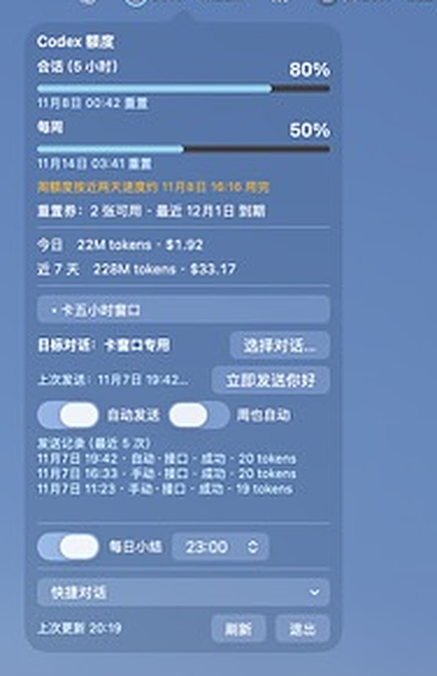
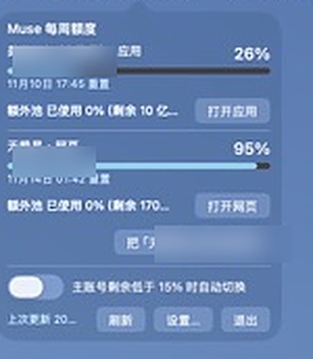
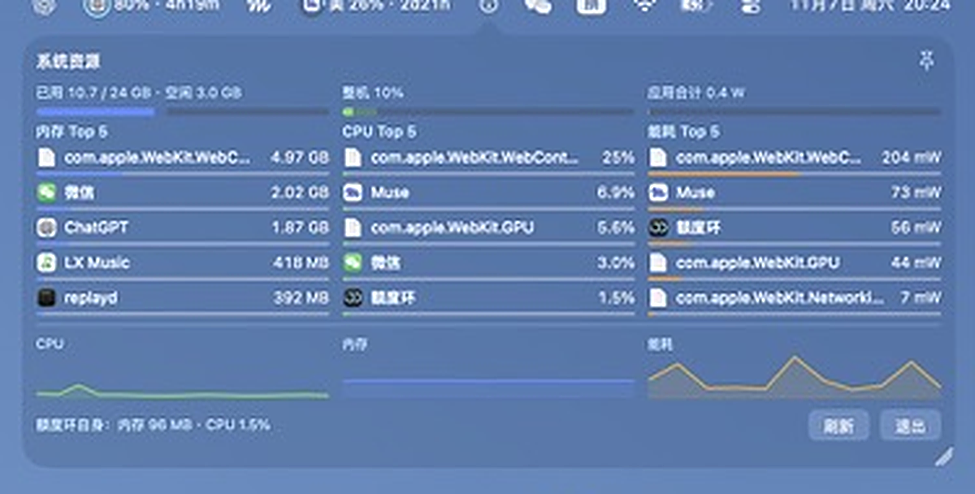

# QuotaMeter （额度环）

A tiny macOS menu bar meter for **OpenAI Codex** and **Muse (muse.ai)** quotas,
plus a lightweight per-app system monitor. One ring per service, always in the
menu bar: remaining percentage and a compact reset countdown at a glance.

[中文说明](README.zh-CN.md)

## Download

Get the ready-to-run app from the [v1.0.0 release page](https://github.com/cxiang519-gif/QuotaMeter/releases/tag/v1.0.0): download `QuotaMeter-1.0.0.zip`, unzip it, and move the app into your Applications folder. The build is ad-hoc signed and not notarized yet, so the first launch needs one trip to System Settings → Privacy & Security → "Open Anyway" (details on the release page).






## Features

**Codex**
- 5-hour and weekly rate-limit windows; hovering the menu bar item swaps
  between them, the panel shows both with bars.
- Rate-limit reset credits, with expiry dates and notifications 3 days and
  1 day before a credit expires.
- Token and cost statistics computed locally from Codex session logs
  (`~/.codex/sessions`), priced with the [models.dev](https://models.dev)
  catalog. Shown in the tooltip and the panel, never in the menu bar.
- Weekly exhaustion forecast from your recent burn rate, and a daily digest
  notification at an hour you choose.

**Window keeper (optional, off by default)**
- Right after a 5-hour window resets, QuotaMeter can automatically send a
  tiny "hello" so a fresh window starts immediately instead of whenever you
  next sit down. The ping goes through the Codex responses API directly
  (~20 tokens), with a `codex exec resume` fallback into a conversation you
  pick. A separate switch does the same for the weekly window, and the ping
  is skipped automatically when weekly remaining drops under 10%.

**Muse (muse.ai)**
- Weekly usage percentage, tokens-left label, and your banked (top-up) pool
  balance.
- Two accounts at once: renameable, with a primary account, optional
  automatic primary switching when the primary runs low, and one-click
  opening of each account either in the Muse app or in an isolated,
  pre-warmed in-app web view (signed in with the same cookie you monitor).

**Shortcuts**
- User-defined conversation links in the Codex panel; ChatGPT app deep
  links (`codex://…`) wake the app directly, web links fall back to the
  browser.

**System monitor**
- A third menu bar item shows per-app **memory / CPU / energy** top-5 lists
  (processes grouped by their outermost `.app`), share bars measured against
  real totals — energy is normalized to your chip's design peak — and
  one-hour sparklines for the whole machine.
- The panel can be pinned and resized. Sampling runs **only while the panel
  is open**; QuotaMeter's own footprint is shown at the bottom of the panel
  and in the item's tooltip.

**Notifications** — any quota under 15%, reset credits about to expire, and
window resets.

## Requirements

- macOS 26 (Tahoe) — QuotaMeter is built with the macOS 26 SDK and developed
  and tested on macOS 26.
- Xcode Command Line Tools (`xcode-select --install`) to build.
- For Codex: the Codex CLI signed in on this machine (QuotaMeter reads, but
  never writes, `~/.codex/auth.json`).
- For Muse: a muse.ai account cookie (see setup below).
- No third-party dependencies. Pure Swift + AppKit.

## Build & install

```sh
./build.sh            # builds ./QuotaMeter.app
./build.sh --install  # builds, installs to /Applications, and launches
```

The app is ad-hoc signed. If macOS blocks the first launch, right-click the
app and choose **Open**.

## Setup

### Codex
Nothing to do — if the Codex CLI works on your machine, the ring lights up.

### Muse (muse.ai)
The muse.ai usage endpoint needs your signed-in session cookie. QuotaMeter
asks for it in **Settings…** (right-click a menu bar item, or use the
Settings button in a panel):

1. Open [muse.ai](https://muse.ai) in Chrome and sign in.
2. Open DevTools (`⌥⌘I`) → **Network** tab → reload the page.
3. Click any request to `muse.ai`, find the **Cookie** request header, and
   copy its full value.
4. Paste it into the account's Cookie field in QuotaMeter's Settings and
   close the window.

Repeat with a second browser profile for a second account. Notes:

- The cookie lives only in the app's `UserDefaults` on your Mac and is sent
  only to `muse.ai`. It is never logged.
- Signing out of muse.ai in the browser invalidates the pasted cookie; just
  paste a fresh one.
- The server-action ID used by the endpoint rotates with site deploys;
  QuotaMeter rediscovers it automatically (the same approach as
  [CodexBar](https://github.com/steipete/CodexBar)).

## Privacy

Everything is computed and stored on your Mac. There is no telemetry, no
analytics, and no server of ours. Network traffic goes only to `muse.ai`,
`chatgpt.com` (with your own credentials), and `models.dev` (public price
catalog, cached for 24h).

## How it works

- **Muse**: `POST https://muse.ai/` server action with your cookie;
  percent-based usage, top-up balance, reset time. Adapted protocol,
  reimplemented — see [THIRD_PARTY_NOTICES.md](THIRD_PARTY_NOTICES.md).
- **Codex**: `GET chatgpt.com/backend-api/wham/usage` and
  `/wham/rate-limit-reset-credits` with the Codex CLI OAuth token.
- **Stats**: local session-log scan (`token_count` events), per-file caching
  so unchanged logs are never rescanned.
- **System monitor**: `proc_pid_rusage` footprints and energy accounting,
  sampled at 4-second intervals only while the panel is open.
- **Refresh**: adaptive — 1 minute while Codex is active, 30 minutes when
  idle. No extra background polling is added by any feature.

## Disclaimer

Unofficial tool. Not affiliated with Meta or OpenAI. It talks to
undocumented endpoints using **your own** credentials, locally:

- muse.ai — the `fetchSubscriptionAction` server action
- chatgpt.com — `/wham/usage`, `/wham/rate-limit-reset-credits`, and
  `/backend-api/codex/responses` (the window-keeper ping)

These are not public APIs. They can change, break, or stop working at any
time, and using them may be subject to each service's terms. Use at your
own risk. The optional window-keeper ping posts a real (tiny) message
through your own Codex account — that is exactly what it is for, and it is
off by default.

## Localization

The UI is currently Chinese only. An English localization is planned if
there is interest — please open an issue, or send a PR.

## License

[MIT](LICENSE). Third-party credits: [THIRD_PARTY_NOTICES.md](THIRD_PARTY_NOTICES.md).
