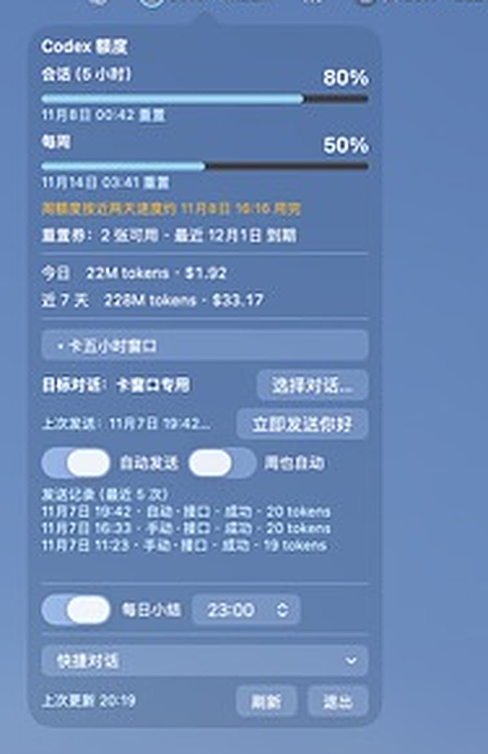
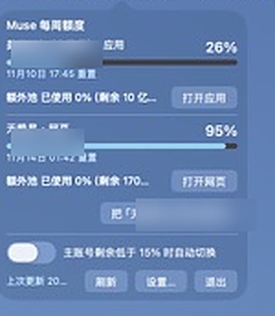
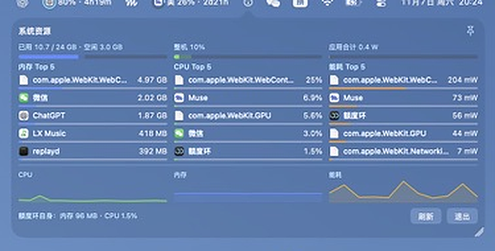

# QuotaMeter（额度环）

一个 macOS 菜单栏小工具，常驻显示 **OpenAI Codex** 与 **Muse（muse.ai）** 的剩余额度，
外加一个轻量的按应用系统资源监控。每个服务一个圆环：剩余百分比＋紧凑的重置倒计时，一眼可见。

[English](README.md)

## 下载

到 [v1.0.0 发布页](https://github.com/cxiang519-gif/QuotaMeter/releases/tag/v1.0.0) 下载 `QuotaMeter-1.0.0.zip`，解压后把应用拖进「应用程序」文件夹。本版为自签名、尚未公证，首次打开要去 系统设置 → 隐私与安全性 点一次「仍要打开」（细节在发布页里）。






## 功能

**Codex**
- 五小时与每周两个额度窗口：悬停菜单栏项可在两者间切换，面板里两条都在。
- 重置券（rate-limit reset credits）及到期日，过期前 3 天、1 天各通知一次。
- token 量与费用统计：本地扫描 Codex 会话日志（`~/.codex/sessions`），
  按 [models.dev](https://models.dev) 目录价估算。只出现在悬停提示和面板里，不占菜单栏。
- 周额度耗尽预测（按近期消耗速度推算），以及可自选时间的每日小结通知。

**卡窗口（可选，默认关闭）**
- 五小时窗口一重置，自动发出一句极小的「你好」，让新窗口立刻开始计时，
  而不是等你下次坐到电脑前。优先走 Codex responses 接口直发（约 20 个 token），
  失败时退回 `codex exec resume` 到你选定的对话。周窗口有独立开关；
  周额度剩余低于 10% 时自动跳过。

**Muse（muse.ai）**
- 每周已用百分比、剩余 token 文案、banked（额外池）余额。
- 双账号同时监控：可改名、可设主账号、主账号过低时可自动切换主账号；
  每个账号可一键在 Muse 应用中打开，或在应用内隔离的网页窗中打开
  （用监控同一份 Cookie 登录，网页窗会预热，点开即到）。

**快捷对话**
- Codex 面板里自加对话链接：`codex://` 深链直接唤醒 ChatGPT 应用定位到对话，
  网页链接接不住时退回浏览器。

**系统监控**
- 第三个菜单栏项：按应用分组的**内存 / CPU / 能耗**前五名
  （进程按最外层 `.app` 归组），条长按真实总量计——能耗以芯片设计峰值为满格；
  另有整机一小时曲线。
- 面板可图钉常驻、可拖动调宽。**只在面板打开时采样**；
  额度环自身的占用显示在面板底部和悬停提示里。

**通知**——任一额度低于 15%、重置券临期、窗口重置完成。

## 环境要求

- macOS 26（Tahoe）：使用 macOS 26 SDK 构建，在 macOS 26 上开发与测试。
- 构建需要 Xcode 命令行工具（`xcode-select --install`）。
- Codex：本机已登录的 Codex CLI（额度环只读 `~/.codex/auth.json`，从不写它）。
- Muse：一个 muse.ai 的登录 Cookie（见下方设置）。
- 零第三方依赖，纯 Swift + AppKit。

## 构建与安装

```sh
./build.sh            # 构建出 ./QuotaMeter.app
./build.sh --install  # 构建、装到 /Applications 并启动
```

应用为自签名。首次启动若被系统拦下，右键应用选「打开」。

## 设置

### Codex
无需设置——本机 Codex CLI 能用，圆环就会亮。

### Muse（muse.ai）
muse.ai 的额度接口需要登录态 Cookie，在**设置**里粘入
（面板里的「设置…」按钮）：

1. 用 Chrome 打开 [muse.ai](https://muse.ai) 并登录。
2. 打开开发者工具（`⌥⌘I`）→ **网络（Network）**页 → 刷新页面。
3. 点任意一条发往 `muse.ai` 的请求，找到请求头里的 **Cookie**，复制完整值。
4. 粘贴到额度环设置里对应账号的 Cookie 框，关窗即生效。

第二个账号用另一个浏览器配置文件重复一遍即可。注意：

- Cookie 只存在本机应用的 `UserDefaults` 里，只发往 `muse.ai`，从不写进日志。
- 在浏览器里退出 muse.ai 登录会让已粘的 Cookie 失效，重新粘一次即可。
- 接口的 server-action ID 会随站点部署轮换，额度环会自动重新发现
  （与 [CodexBar](https://github.com/steipete/CodexBar) 相同的做法）。

## 隐私

所有数据都在你的 Mac 上计算和保存。没有遥测、没有统计、没有我们的服务器。
网络请求只发往 `muse.ai`、`chatgpt.com`（用你自己的凭据）和
`models.dev`（公开价格目录，缓存 24 小时）。

## 实现说明

- **Muse**：带 Cookie 向 `https://muse.ai/` 发 server-action POST，
  返回百分比用量、额外池余额与重置时间。协议为参考后重新实现，
  见 [THIRD_PARTY_NOTICES.md](THIRD_PARTY_NOTICES.md)。
- **Codex**：用 Codex CLI 的 OAuth 令牌请求
  `GET chatgpt.com/backend-api/wham/usage` 与 `/wham/rate-limit-reset-credits`。
- **统计**：扫描本地会话日志的 `token_count` 事件，按文件缓存，未变文件不重扫。
- **系统监控**：`proc_pid_rusage` 的 footprint 与能耗记账，
  只在面板打开时每 4 秒采样一次。
- **刷新**：自适应——Codex 活跃时 1 分钟，闲时 30 分钟；任何功能都不新增常驻轮询。

## 免责声明

非官方工具，与 Meta、OpenAI 无关。它使用**你自己的**凭据在本机访问
以下非公开接口：

- muse.ai —— `fetchSubscriptionAction` server action
- chatgpt.com —— `/wham/usage`、`/wham/rate-limit-reset-credits`、
  `/backend-api/codex/responses`（卡窗口所用的接口）

这些都不是公开 API，随时可能变更、失效或被封禁，使用方式受各服务
条款约束，风险自担。可选的「卡窗口」会通过你自己的 Codex 账号
发出一条真实的（极小的）消息——这正是它的用途，且默认关闭。

## 多语言

界面目前只有中文。如有其他语言需求，欢迎提 issue 或 PR 参与本地化。

## 许可

[MIT](LICENSE)。第三方致谢：[THIRD_PARTY_NOTICES.md](THIRD_PARTY_NOTICES.md)。
